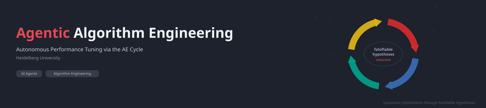
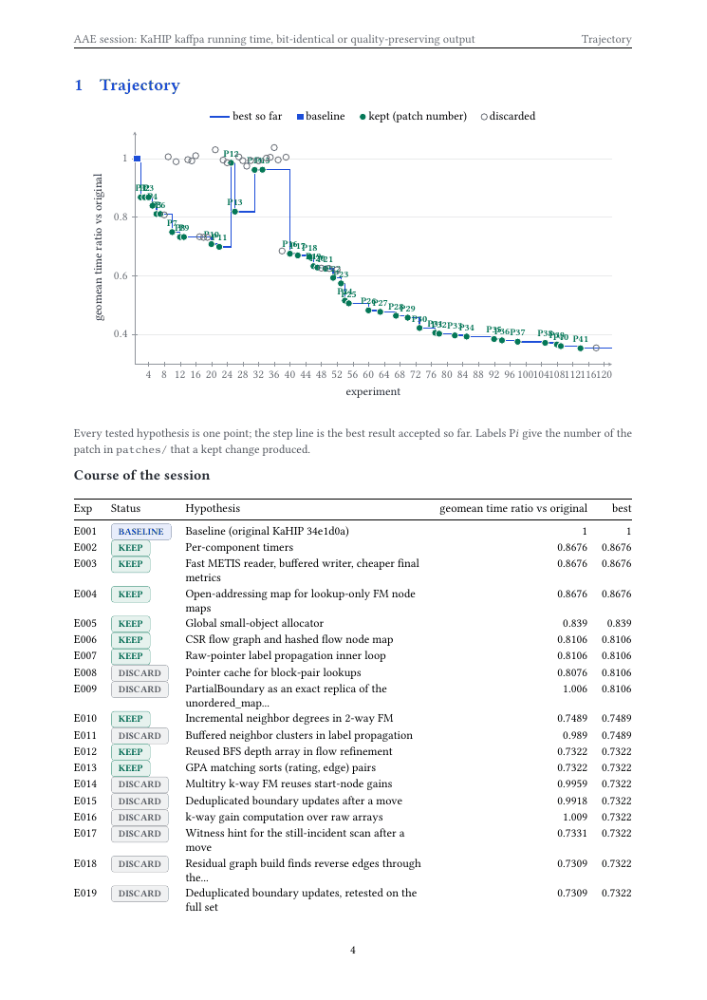
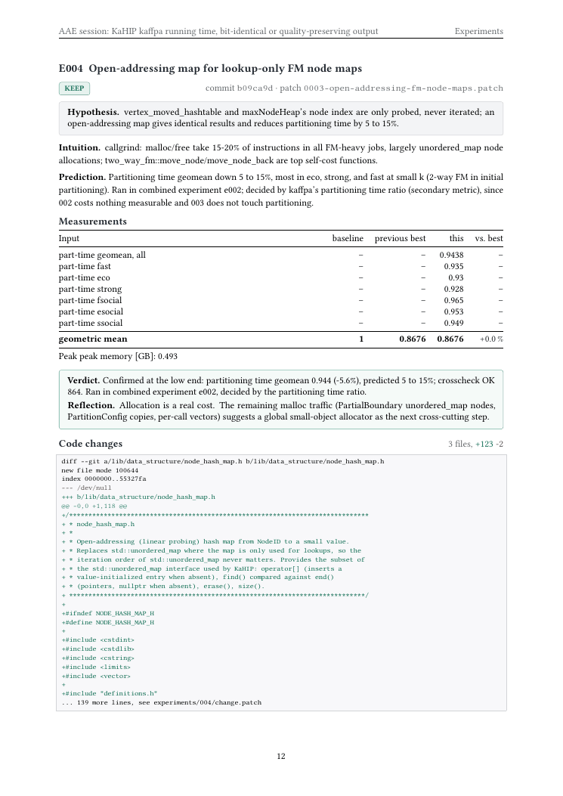
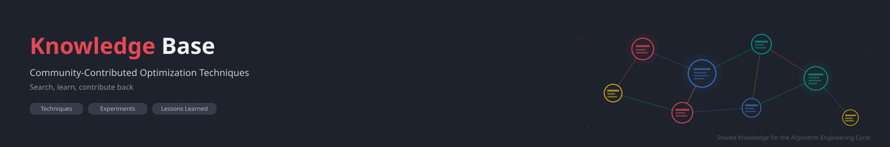

<p align="center">
  
</p>

# Agentic Algorithm Engineering

[](https://doi.org/10.5281/zenodo.24537749)

This repository contains the program definition for **Agentic Algorithm Engineering (AAE)**, a methodology that turns autonomous agents into performance engineers following the Algorithm Engineering cycle: design, analysis, implementation, and experimental evaluation, driven by falsifiable hypotheses.

See [AAE.md](AAE.md) for the full program definition. Besides the optimized code, every AAE session produces two artifacts: one numbered patch per accepted change in `patches/`, and a PDF report in `report/` with the trajectory of the metric and one page per tested hypothesis (intuition, prediction, code change, measurements, verdict).

The methodology is described in the paper [Agentic Algorithm Engineering: Improving Shared-Memory Exact Minimum Cuts](https://arxiv.org/abs/2609.07204) (13th DIMACS Implementation Challenge, to appear), which applies AAE to the shared-memory exact minimum cut solver [VieCut](https://github.com/VieCut/VieCut). See [Citation](#citation) below if you use AAE in your work.

## Example Results

AAE sessions on established open-source codes. Every kept change was checked against the original output.

| Code | Problem | Result | Correctness | Details |
|---|---|---|---|---|
| [VieCut](https://github.com/KaHIP/VieCut) | exact minimum cut | **8.9x faster** on 1 thread, 8.8x on 32 threads; no longer runs out of memory on large-cut graphs | every cut unchanged | [v2.0](https://github.com/KaHIP/VieCut/releases/tag/v2.0), [paper](https://arxiv.org/abs/2609.07204) |
| [KaHIP](https://github.com/KaHIP/KaHIP) `kaffpa` | graph partitioning | **3.9x faster** in total time (2.8x geometric mean over 537 runs) | partition quality unchanged | [v3.26](https://github.com/KaHIP/KaHIP/releases/tag/v3.26), [report](examples/reports/kahip_kaffpa_speed_report.pdf) |
| KaHIP `ultra` | graph partitioning quality | **2.2% smaller cuts** than `strong` (about 7% on social graphs), in less time than `strong` of v3.25 | same balance rule as `strong` | [v3.28](https://github.com/KaHIP/KaHIP/releases/tag/v3.28), [ultra.pdf](https://github.com/KaHIP/KaHIP/blob/master/manual/ultra.pdf) |
| Hochbaum's pseudoflow | maximum flow | **3.0x faster** in total (3.18x geometric mean over 164 DIMACS instances) | flow value verified on every instance | [KB 039](knowledge-base/039-pseudoflow-solve-direction.md) |
| [FREIGHT](https://github.com/KaHIP/FREIGHT) | streaming hypergraph partitioning | **1.82x faster** | bit-identical output | [KB 035](knowledge-base/035-streaming-hypergraph-multipass-eval.md) |
| [ParHIP](https://github.com/KaHIP/KaHIP) | distributed graph partitioning (MPI) | **1.61x faster** partitioning, 1.77x faster I/O (session ongoing) | byte-identical partitions | [KB 040](knowledge-base/040-parhip-bit-identical-speedup.md) |
| [ScalableCorrelationClustering](https://github.com/KaHIP/ScalableCorrelationClustering) | correlation clustering | **1.24x faster** | identical solution quality | [v1.2](https://github.com/KaHIP/ScalableCorrelationClustering/releases/tag/v1.2), [KB 034](knowledge-base/034-graph-clustering-lp-refinement.md) |

Each session also produced a PDF report with one page per tested hypothesis, and its lessons went into the [knowledge base](knowledge-base/).

### Example Report

The full report of the KaHIP `kaffpa` session: 122 experiments, 69 hypotheses (41 kept, 28 discarded), 41 patches, 3.9x faster in total with every partition checked ([PDF, 90 pages](examples/reports/kahip_kaffpa_speed_report.pdf)).

<p align="center">
  <a href="examples/reports/kahip_kaffpa_speed_report.pdf"></a>
  <a href="examples/reports/kahip_kaffpa_speed_report.pdf"></a>
</p>
<p align="center"><em>Trajectory of the running time over all experiments, and one of the pages per hypothesis (hypothesis, prediction, measurements, verdict, code change)</em></p>

## Quick Start

In Claude Code:

```
/plugin install aae --marketplace CHSZLab/AgenticAlgorithmEngineering
/aae:aae make the solver in src/ faster on the graphs in data/
```

The agent first agrees with you on the benchmark, the metric, the correctness checks and the budget, then runs the loop on its own and leaves the accepted patches and a report. For Codex and other agents, see [Installation](#installation).

## Algorithm Engineering

Algorithm Engineering, as defined by [Sanders (2009)](https://doi.org/10.1007/978-3-642-03456-5_22), is a methodology for algorithmic research built around a cycle of design, analysis, implementation, and experimental evaluation. Unlike traditional algorithmics, which often stops at theoretical analysis, algorithm engineering insists on closing the loop: hypotheses about algorithm performance are tested experimentally on realistic inputs, and the results feed back into improved designs. Central to this process are falsifiable hypotheses, following Popper's scientific method applied to algorithms.

Agentic Algorithm Engineering takes this methodology and hands the cycle to an autonomous AI agent. The agent formulates hypotheses, implements changes, runs experiments, and evaluates results, iterating continuously without human intervention. This allows systematic, high-throughput exploration of the optimization space while maintaining the scientific rigor of the AE methodology.

## How AAE Compares

AAE belongs to a family of tools in which AI agents improve code by running experiments. They differ in what they work on and in what you get at the end.

[autoresearch](https://github.com/karpathy/autoresearch) lets an agent edit one training script for a small language model, train for five minutes, and keep the change if the validation loss improved. AAE uses the same keep-or-discard loop, but on any existing code base, in any language and for any metric, and it adds the parts of the Algorithm Engineering method that make the results trustworthy and reusable: a falsifiable hypothesis with a predicted effect before every experiment, correctness assertions checked after every change, one reviewable patch per accepted change, and a report.

[AlphaEvolve](https://arxiv.org/abs/2506.13131), [OpenEvolve](https://github.com/algorithmicsuperintelligence/openevolve) and [ShinkaEvolve](https://github.com/SakanaAI/ShinkaEvolve) evolve a population of program variants: a language model proposes mutations, an evaluator scores every variant, and evolutionary search keeps the best. They are strong at discovering new algorithms and heuristics for problems that can be scored automatically, and they evaluate many candidates. AAE instead works like an engineer on an existing code base: fewer, deliberate experiments, each one motivated by profiling and analysis, with the output kept correct throughout. The approaches are complementary.

| | autoresearch | OpenEvolve, ShinkaEvolve | AAE |
|---|---|---|---|
| Works on | one training script | code blocks scored by an evaluator | any existing code base and language |
| Search | one agent, keep or discard | language-model mutations plus an evolutionary population | one agent following the Algorithm Engineering cycle |
| Before each experiment | the agent's next idea | a proposed mutation | a falsifiable hypothesis with its predicted effect |
| Correctness | the metric (validation loss) | the evaluator score | assertions agreed with you, checked after every change (e.g. bit-identical output) |
| What you get | improved script and experiment log | best program and population | one Git patch per accepted change, a PDF report with one page per hypothesis, and lessons in a shared knowledge base |
| How it runs | an agent prompted with `program.md` | a Python framework calling language models | a skill or plugin in Claude Code or Codex |

## Knowledge Base

<p align="center">
  
</p>

The project includes a community-contributed [knowledge base](knowledge-base/) of optimization techniques, experiment results, and lessons learned from AAE sessions. Browse `knowledge-base/INDEX.md` for an overview, or contribute your own findings (see `knowledge-base/CONTRIBUTING.md`).

## Installation

### Claude Code

Inside Claude Code, type:

```
/plugin install aae --marketplace CHSZLab/AgenticAlgorithmEngineering
```

Then type `/aae:aae` (or just ask Claude Code to optimize something with AAE) and say what to optimize, e.g. `/aae:aae make the solver in src/ faster on the graphs in data/`.

On Claude Code versions before 2.1.275, add the marketplace first: `/plugin marketplace add CHSZLab/AgenticAlgorithmEngineering`, then `/plugin install aae@aae`.

Without the plugin system, a plain clone works too (the skill is then called `/aae`):

```bash
git clone https://github.com/CHSZLab/AgenticAlgorithmEngineering ~/.claude/skills/aae
```

Using another agent? Just tell it to follow [AAE.md](AAE.md).

<details>
<summary>Details: updating, per-project install, report requirements</summary>

- Update: `/plugin update aae` (plugin) or `git -C ~/.claude/skills/aae pull` (clone).
- Install for one project only: clone into `.claude/skills/aae` inside that project instead.
- The PDF report needs Python 3 and LaTeX (TeX Live with `latexmk`). Without LaTeX, the session still runs and keeps the patches; only the PDF is skipped.

</details>

### Codex

Inside a Codex session, ask:

```text
Install AAE as a Codex skill from https://github.com/CHSZLab/AgenticAlgorithmEngineering.
Clone the repository and run its scripts/install_codex_skill.py installer,
including the report templates and knowledge base.
```

Codex runs the installation for you; there is no need to open a separate terminal.
If the repository is already checked out, ask Codex to install from that checkout instead.

<details>
<summary>Manual installation from a terminal</summary>

Clone the framework and install the bundled skill, including the report templates and knowledge base:

```bash
git clone https://github.com/CHSZLab/AgenticAlgorithmEngineering.git
cd AgenticAlgorithmEngineering
python3 scripts/install_codex_skill.py
```

</details>

The installer copies a self-contained skill to `${CODEX_HOME:-~/.codex}/skills/aae` and refuses to overwrite an existing installation. It includes only the report source files, not generated PDFs or build logs. The skill is available on your next Codex turn. Invoke it in the target project:

```text
$aae make the solver in src/ faster on the graphs in data/; run at most 20 experiments
```

For the best unattended AAE experience with Codex CLI, launch Codex in **YOLO mode** from the target project directory:

```bash
codex --yolo
```

`--yolo` is an alias for `--dangerously-bypass-approvals-and-sandbox`: it skips approval prompts and disables Codex's command sandbox, allowing the experiment loop to proceed without permission interruptions. Use it in a trusted, externally isolated environment such as a dedicated container or VM. It does not remove session execution limits or replace the agreed experiment budget.

Specify target files, benchmark command, metric and direction, correctness requirements, and an experiment count or time budget. Codex follows the same AE cycle and produces `results.tsv`, accepted patches, and report sources (plus a PDF when LaTeX is available). Session checkpoints support continuation after interruption.

For a project-local installation, run from this checkout:

```bash
python3 scripts/install_codex_skill.py --dest /path/to/project/.agents/skills
```

To update, pull this checkout and install into a new destination, or move the existing `aae` skill aside before reinstalling. Existing installations are never overwritten automatically. See the [official skills documentation](https://developers.openai.com/codex/skills) for Codex skill discovery and invocation.

## Usage

To try AAE before using it on your own code, run the 10-minute [quick-start example](examples/quickstart/): a slow but correct shortest-path program with a benchmark and a correctness check.

Agree on the target, benchmark, correctness assertions, and run budget during setup, then let the agent execute the AE cycle within its configured permissions. Codex supports bounded sessions and checkpoints; see [Codex sessions](AAE.md#codex-sessions). An open-ended session runs until interrupted, subject to the host's execution limits. The Claude Code orchestration options below apply to Claude Code only.

### Multi-component AAE

At session start, the agent offers **multi-component AAE**, useful for long-running systems and algorithms where a separate full benchmark for every hypothesis would be expensive. The agent instruments the target code and tests multiple hypotheses in one shared benchmark run, with one hypothesis per component. It compares each component's profile against an instrumented baseline to decide independently which changes to keep or discard.

Each component change gets its own Git commit before the shared run, so it can be reverted with `git revert <component-commit>` without removing the other changes. Shared profiling instrumentation has a separate commit. The agent records a hypothesis, component commit hash, measurement, and verdict for each component and exports each accepted component commit as its own numbered patch.

If component interactions or profiling overhead prevent reliable attribution, the agent tests those hypotheses separately. It validates the retained combination against the overall performance metric and correctness assertions, keeping the benchmark harness unchanged.

To request this mode explicitly, include this in your prompt to either Codex or Claude Code:

```text
Use multi-component AAE: instrument the components, test one hypothesis per
component in a shared benchmark run, and commit each component change separately.
```

### Keeping the Loop Alive with Agent Teams

In practice, even with `--dangerously-skip-permissions`, the agent may eventually stop and ask for user input instead of continuing the loop. To solve this, use Claude Code's **Agent Teams** feature to set up a manager/executor pair that keeps the loop running autonomously.

**How it works:** A manager agent monitors an executor agent that runs the AAE program. Whenever the executor pauses and asks for input, the manager tells it to continue.

**Setup:**

1. Enable agent teams by setting the environment variable:
   ```bash
   export CLAUDE_CODE_EXPERIMENTAL_AGENT_TEAMS=1
   ```
   Or add it to your `settings.json`:
   ```json
   {
     "env": {
       "CLAUDE_CODE_EXPERIMENTAL_AGENT_TEAMS": "1"
     }
   }
   ```

2. Launch Claude Code with `--dangerously-skip-permissions` and instruct it to create a two-agent team:
   - **Manager**: monitors the executor and, whenever it stops or asks for input, sends it a message to continue the AAE loop.
   - **Executor**: runs the AAE program (`AAE.md`) in the target project directory, performing the full experiment cycle.

   Example prompt for the manager:
   ```
   Create an agent team with one executor teammate. The executor should run
   the AAE program defined in AAE.md on this project. Your job as manager is
   to monitor the executor. Whenever it stops, pauses, or asks for input,
   tell it to continue the experiment loop. Never let it idle.
   ```

3. The manager uses tmux split panes (or in-process mode with `Shift+Down`) to monitor the executor and send follow-up messages when needed.

This orchestration ensures the AE cycle runs truly unattended, even across context window boundaries or when the executor would otherwise break out of the loop.

### Keeping the Loop Alive with `/loop`

A simpler alternative to agent teams is Claude Code's built-in `/loop` command. It re-sends a prompt at a fixed interval, nudging the agent to continue if it has stalled:

```
/loop 30m continue the AAE loop
```

This sends "continue the AAE loop" every 30 minutes. If the agent is still running, the message is queued; if it has stopped or is waiting for input, it restarts the cycle. Combined with `--dangerously-skip-permissions`, this provides a lightweight safeguard against the agent silently exiting the AE loop.

## Citation

If you use Agentic Algorithm Engineering in your research, please cite the following paper:

> David A. Bader, Adil Chhabra, Ernestine Großmann, Monika Henzinger, Alexander Noe, and Christian Schulz. *Agentic Algorithm Engineering: Improving Shared-Memory Exact Minimum Cuts*. In 13th DIMACS Implementation Challenge Workshop: Network Flows 2.0, OASIcs, 2027. To appear. Preprint: https://arxiv.org/abs/2609.07204

```bibtex
@inproceedings{bader2027agenticalgorithmengineering,
  title         = {Agentic Algorithm Engineering: Improving Shared-Memory Exact Minimum Cuts},
  author        = {David A. Bader and Adil Chhabra and Ernestine Gro{\ss}mann and Monika Henzinger and Alexander Noe and Christian Schulz},
  booktitle     = {13th DIMACS Implementation Challenge Workshop: Network Flows 2.0},
  series        = {OASIcs},
  publisher     = {Schloss Dagstuhl -- Leibniz-Zentrum f{\"u}r Informatik},
  year          = {2027},
  note          = {To appear},
  eprint        = {2609.07204},
  archivePrefix = {arXiv},
  url           = {https://arxiv.org/abs/2609.07204}
}
```

To cite the software itself, use its Zenodo DOI [10.5281/zenodo.24537749](https://doi.org/10.5281/zenodo.24537749), which always resolves to the latest release; each release also has its own DOI on Zenodo.

## Author

Christian Schulz, [Algorithm Engineering Group](https://ae.ifi.uni-heidelberg.de/), Heidelberg University

## Contributing

We welcome contributions! Feel free to open a pull request if you have improvements, extensions, or new ideas.

Questions, results from your own AAE sessions, and ideas are welcome in [Discussions](https://github.com/CHSZLab/AgenticAlgorithmEngineering/discussions); share your results under *Show and tell*.
